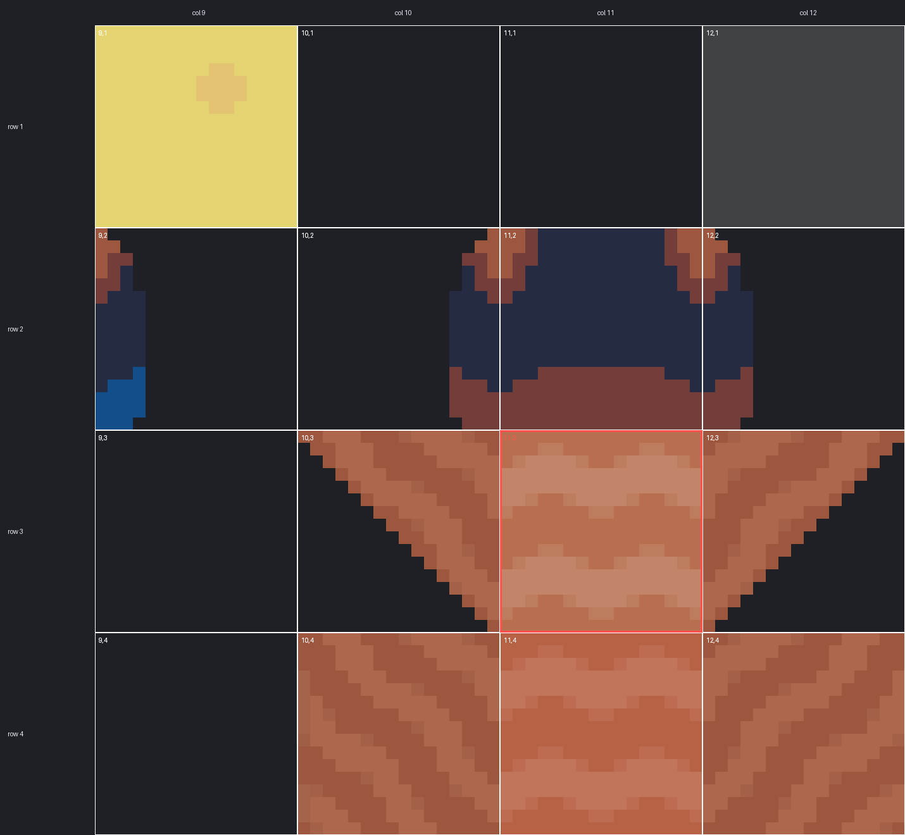
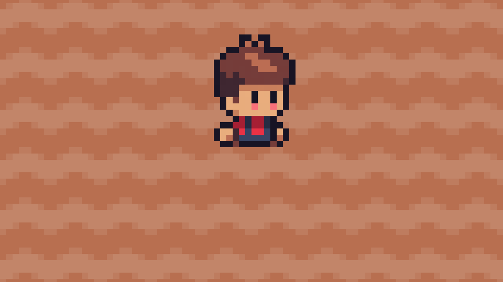

# M2a 第 5 步 · 先手画几块土试试（编辑器操作）

> 日期：2026-11-09
> 目标：在 Godot 编辑器里直接用鼠标画几块耕地，先看看"普通土块"到底长什么样。
> 这一步**不写代码**，纯编辑器操作。

---

## 0. 现状确认（已实测）

| 项目 | 状态 |
|---|---|
| `Soil` 节点的 TileSet | ✅ 已经和 Ground 共用 `TileSet_o5qli` |
| TileSet 的 atlas source | ✅ 指向主图集 `spr_tileset_sunnysideworld_16px.png`，region 16×16 |
| `atlas(11,3)` 是否已创建 | ✅ **已创建**（`scenes/main.tscn` 里能查到 `11:3/0 = 0`），在 TileMap 面板里点得到 |
| atlas source 里已创建的 tile 总数 | 1740 个 |

> **因此无需再配置 TileSet，可直接绘制。**

---

## 1. ⚠️ 修正 1 像素错位

`scenes/main.tscn` 里 `Ground` 节点有：

```
[node name="Ground" type="TileMapLayer" parent="."]
position = Vector2(1, 0)     # ← 这一行
```

该偏移为此前渲染验证时临时加入且未撤销。后果：

```
Ground 的 (20,12) 格 覆盖世界坐标 x = 321 .. 337
Soil   的 (20,12) 格 覆盖世界坐标 x = 320 .. 336
                            ↑ 差 1 像素
```

**Ground 整层向右偏了 1px，Soil 层没偏**，导致绘制的土块与草地错开 1 像素。

### 修法（二选一）

**A. 把 Ground 的偏移去掉**

1. 打开 `scenes/main.tscn`
2. 选中 `Ground` 节点
3. Inspector → **Transform → Position**
4. 把 **X 改成 0**（Y 保持 0）

**B. 给 Soil 也加同样的偏移**

选中 `Soil` → Position → X 改成 1。

> 但 A 更合适：Ground 和 Soil 都在 (0,0)，跟角色的格子算法
> （`floor(x/16)`、`floor((y-4)/16)`）才对得上。
> 角色的初始位置 (336,224) 就是按"16px 网格原点在 (0,0)"算的。

---

## 2. 打开 TileMap 面板

1. 打开 `scenes/main.tscn`
2. 在**左侧 Scene 树**里选中 **`Soil`** 节点（不是 Ground）
   > ⚠️ 必须选中 Soil。TileMap 面板画的是**当前选中节点的** TileMapLayer。
   > 画到 Ground 上会覆盖草地。
3. 编辑器**底部**会出现 **TileMap** 面板
   - 看不到的话：菜单 **Window → 可调整布局 → TileMap**，或用底部面板的 `»` 翻页找

---

## 3. 找到 `atlas(11,3)`

TileMap 面板上半部分是**当前 TileSet 的 tile 缩略图网格**，下半部分是 **Patterns**。

主图集是 1024×1024，每格 16px → **64×64 = 4096 个格子**。面板里格子很小，不容易找。

### 办法 1：用面板的缩放（笨但可靠）

面板左上角有缩放按钮，把视图放大到能看清 16px 的图块，
然后数格子：**从左上角 (0,0) 往下 3 格、往右 11 格**。

### 办法 2：用 Picker 反选

1. 先在 **2D 视图**里随便点一下 Soil 层（会画一块草地 tile，因为默认选中的是 atlas(1,1)）
2. 把 TileMap 面板工具栏切到 **Picker（吸管）** 模式
3. 在 2D 视图中点击**目标土块**

不过第 5 步是代码画的，这一步只是试手感。

### 办法 3：直接看坐标定位图



这张图是主图集 `col 9~12 × row 1~4` 的放大版，**每个格子都标了 atlas 坐标**。
红框那个 **`11,3`** 就是它。

放大后的样子：

```
11,3 = 肉棕色 + 横向犁沟波纹，4 边全不透明，可无缝平铺
11,4 = 同款但颜色更深一点（交替铺会有棋盘感，别用）
```

其余几个可以避开的：

| 坐标 | 是什么 | 为什么不能用 |
|---|---|---|
| `10,3` `12,3` | V 形斜坡（左上/右上暗蓝底） | ❌ 是山丘斜面，不是平地 |
| `10,4` `12,4` | 斜向纹路 | ❌ 纹理方向和 (11,3) 不一致，拼起来很怪 |
| `11,2` | 深蓝底 + 棕色顶 | ❌ 是水面/阴影 |
| `9,1` | 黄色草地 | ❌ 色相不对 |

### 目标效果（`(11,3)` 铺满一整片，真实渲染）



大片铺满时为**连续的一块土**，不显示 16px 网格线 —— 符合预期效果。

---

## 4. 画

1. TileMap 面板工具栏选 **Paint（画笔）** 模式（默认就是）
2. 在 TileMap 面板里点中 `11,3` 那一格（会高亮）
3. 鼠标移到 **2D 视图**，**左键按住拖动**就能画
4. **右键** = 擦掉

画完按 **Ctrl+S** 保存场景。

### 画的时候注意

- **看 Grid 网格线**：2D 视图右上角有网格开关（"Grid"），打开它对齐 16px 格子
- **别画到边界外面**：可活动区是 118×66 格，但 Ground 是 120×68（多一圈当围栏缓冲）
- **画在 Soil 层不是 Ground 层**：确认 Scene 树里选中的是 Soil

---

## 5. 验证画对了

按 **F5** 运行游戏，在 2D 视图里确认：

- [ ] 土块**大小正好 16×16**，和草地严丝合缝
- [ ] 土块**边缘没有黑边/白边**（有的话说明选错了 tile）
- [ ] 多块土拼在一起时**纹理连续**，看得出是一块地
- [ ] 土块**在角色脚下**（角色站在草地上，土块在土上，说明 z 序对）

> 第 4 条的 z 序：Main 的子节点顺序 = 绘制顺序，
> `Ground` → `Soil` → `Boundary` → `Entities`，
> 所以土在草之上、角色之下。层级没问题。

---

## 6. ⚠️ 手画的土块不会"算数"

这一点很重要，注意：

**编辑器中绘制的地块仅作为美术预览。**
`FarmData` 里这些格子的 `state` 仍然是 `UNTILLED`。

所以：
- ✅ 可以用它看看土块好不视觉效果符合预期
- ❌ **不能**靠它测"不能重复锄"——那要看 `FarmData`
- ❌ **不能**靠它测目标格对不对——那要按 F5 真的锄一次

而且第 5 步的代码 `soil.set_cell(cell, 0, SOIL_TILE)` 是**按格子坐标写**的，
手绘土块与代码锄地目标格重合时，**代码会覆盖该格**（同 atlas 就没区别）。

**处理方式**：手绘仅用于验证样式。验证完成后清空 Soil 层，
第 5 步的代码才是真正填土的地方。

清空方法：
- 选中 Soil → TileMap 面板切 **Eraser（橡皮）** → 在 2D 视图里框选 → Delete
- 或者选中 Soil → Inspector → **Tile Map Data** 清空

---

## 7. 下一步

样式满意 → 走 `docs/M2A_STEP5_HOE.md` 的第 3 节，改 `player.gd`，
让按空格真的能锄地。
