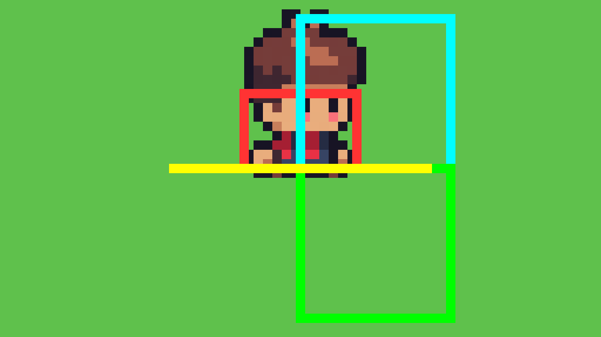

# M2a 第 5 步 · 锄地流程（施工指南）

> 日期：2026-11-09
> 前置：M1（移动/朝向）、三层角色系统、M2a 数据层（FarmData / SoilData）已完成并验收
> 本步目标：按空格 → 播放 dig 动画 → 面向的那一格变成耕地 → 扬起尘土

---

## 0. 这一步要用的素材（我已经备好）

| 文件 | 内容 | 备注 |
|---|---|---|
| `assets/game/soil/soil_tiles.png` | 64×16 = **4 个 16×16 tile 横排** | 顺序：`(0,0)`干土 `(1,0)`湿土 `(2,0)`带小坑 `(3,0)`带大坑 |
| `assets/game/fx/dust_land.png` | 144×9 = **6 帧 24×9 横排** | 尘土落地特效 |

### 0.1 土壤四态语义（已实测确认）

| tile | 源文件 | 底色 | 判定 |
|---|---|---|---|
| `(0,0)` | soil_00 | `[228,166,114]` 亮橙棕 | **干土（已耕未浇水）← 第 5 步用这个** |
| `(1,0)` | soil_01 | `[194,133,105]` 暗橙棕 | 湿土（= soil_00 暗化 62 像素） |
| `(2,0)` | soil_03 | 亮橙棕 + 小深坑 | 干土 + 播种坑 |
| `(3,0)` | soil_04 | 亮橙棕 + 大深坑 | 干土 + 作物 |

原 `soil_02`（推测是"湿土+播种"）在原资源包里就缺失，无法恢复。

### 0.2 尘土帧序

原 GameMaker 工程已删，**真实帧序无法恢复**。我按"面积从小到大"重排了一版
（尘土扬起的过程），**顺序是推测的**，你在 Godot 里看着不对可以直接拖动调整。

```
原文件序面积: [96, 5, 64, 44, 80, 23]
重排后:        [5, 23, 44, 64, 80, 96]   ← 小→大
```

对比图：`docs/images/dust_order.png`

---

## 1. 格子对齐规则（已用真实渲染实测确认）



黄色横线 = 角色的脚（y=224）；红色框 = 碰撞盒（12×8，位于节点 (0,−4)）；青色框 = 格 (21,13)。

**结论：**

- 碰撞盒完整落在**青框**里，脚正好压在青框的下边界
- **绿框**（格 21,14）是角色**正前方**那一格

所以：

```gdscript
func _player_cell() -> Vector2i:
	return Vector2i(
		int(floor(position.x / 16.0)),
		int(floor((position.y - 4.0) / 16.0))   # -4 = CollisionShape2D 的 y 偏移
	)
```

**目标格 = 角色格 + facing 向量**（面朝下就是绿框，实测位置正确）。

> 为什么是 `y - 4` 而不是 `y`？
> 碰撞形状 12×8 挂在 `CollisionShape2D` 上、位置 `(0, -4)`，所以碰撞盒中心在节点 y−4。
> 用碰撞盒中心所在格，才和"角色站在这一格"的视觉一致。
> 旧的 `floor((y-1)/16)` 规则在 224 这个初始位置结果相同，但物理意义不如碰撞盒中心明确。

---

## 2. 素材准备（Godot 编辑器里做）

### 2.1 给 Soil 层建一个独立 TileSet

Soil 层现在挂着主图集的 `TileSet_o5qli`，**里面没有耕地 tile**，而且主图集不能手改
（1740 个 atlas 坐标）。所以给 Soil 层单独建一套：

1. 打开 `scenes/main.tscn`，选中 `Soil` 节点
2. Inspector → `Tile Set` → 点 **新建**（New TileSet）→ 保存为 `assets/game/soil/Soil_TileSet.tres`
3. 在 TileSet 面板底部 **Atlas Sources** 区域 → **Add Atlas Source**
   （如果已有 source，先把它删掉，只留这一个）
4. `Texture` 选 `res://assets/game/soil/soil_tiles.png`
5. **Texture Region Size** = `(16, 16)`，`Separation` = `(0, 0)`，`Margins` = `(0, 0)`
6. → 自动生成 4 个 tile，atlas 坐标依次是 `(0,0) (1,0) (2,0) (3,0)`
7. **TileSet 的 `tile_size` 保持 `(16,16)`** ← 关键，保证 Soil 网格与 Ground 的 16×16 对齐

> 注意：源图 `soil_XX.png` 是 16×12，我打包时上下各补了 2 像素透明做成 16×16，
> 所以土块在格子里是垂直居中的，上下会露出 2 像素草地。
> 如果你觉得位置不对，可以在 TileSet 里调 tile 的 `texture_region_offset`。

### 2.2 给 Soil 节点加一个 group

Soil 是 Main 的子节点，player.gd 要拿到它。加个 group 最省事：

1. 选中 `Soil` 节点 → Node 面板 → **Groups** → 新建 group，名字填 `soil`
2. （可重复添加）

### 2.3 尘土不用建 SpriteFrames

`AnimatedSprite2D` 自带 `hframes` 属性，直接把整条 strip 当纹理用即可，
**不需要建 SpriteFrames 资源**：

```gdscript
dust.texture = load("res://assets/game/fx/dust_land.png")
dust.hframes = 6
dust.play("default")     # 用 hframes 时动画名固定是 "default"
```

---

## 3. player.gd 的改动

### 3.1 新增常量与变量

```gdscript
const TILE_SIZE := 16
const FARM_SIZE := Vector2i(40, 26)

# soil_tiles.png 里的 atlas 坐标
const SOIL_DRY    := Vector2i(0, 0)
const SOIL_WET    := Vector2i(1, 0)
const SOIL_SEEDED := Vector2i(2, 0)
const SOIL_PLANTED := Vector2i(3, 0)

var _busy := false          # 锄地中：锁移动 + 锁朝向
var _target := Vector2i.ZERO   # 目标格在开始时锁存
```

### 3.2 `_physics_process` 里加锁

```gdscript
func _physics_process(delta: float) -> void:
	if _busy:
		velocity = Vector2.ZERO
		move_and_slide()
		return          # 提前返回 → 朝向不会被改动
	# ... 原有逻辑不动 ...
```

> 三处锁：`_busy` 期间 velocity=0（锁移动）、提前 return（锁朝向）、
> 目标格在开始时锁存到 `_target`（锁目标）。
> **少了任何一个，按住方向键就会在锄地过程中改变落锄位置。**

### 3.3 触发锄地

在 `_physics_process` 里（`_busy` 判断之后）加：

```gdscript
	if Input.is_action_just_pressed("use_tool"):
		_start_dig()
```

### 3.4 三个新函数

```gdscript
func _player_cell() -> Vector2i:
	return Vector2i(
		int(floor(position.x / TILE_SIZE)),
		int(floor((position.y - 4.0) / TILE_SIZE))
	)


func _target_cell() -> Vector2i:
	var c := _player_cell()
	match facing:
		Vector2i.UP:    return c + Vector2i(0, -1)
		Vector2i.DOWN:  return c + Vector2i(0, 1)
		Vector2i.LEFT:  return c + Vector2i(-1, 0)
		Vector2i.RIGHT: return c + Vector2i(1, 0)
	return Vector2i(-999, -999)


func _start_dig() -> void:
	if _busy:
		return
	var cell := _target_cell()
	# 越界
	if cell.x < 0 or cell.x >= FARM_SIZE.x or cell.y < 0 or cell.y >= FARM_SIZE.y:
		return
	# 已经锄过
	if FarmData.is_tilled(cell):
		return

	_busy = true
	_target = cell          # ← 锁存目标格
	_play_anim("dig")

	# 等到"锄头落地"那一刻再改地块
	var dur := _anim_duration("dig")
	await get_tree().create_timer(dur * 0.45).timeout
	_apply_till(_target)


func _anim_duration(anim_name: String) -> float:
	var sf := animation.sprite_frames
	return float(sf.get_frame_count(anim_name)) / sf.get_animation_speed(anim_name)


func _apply_till(cell: Vector2i) -> void:
	if not FarmData.till(cell):
		return
	var soil: TileMapLayer = get_tree().get_first_node_in_group("soil")
	if soil == null:
		return
	soil.set_cell(cell, 0, SOIL_DRY)
	_spawn_dust(cell)


func _spawn_dust(cell: Vector2i) -> void:
	var dust := AnimatedSprite2D.new()
	dust.texture = load("res://assets/game/fx/dust_land.png")
	dust.hframes = 6
	dust.speed = 15.0            # 6 帧 / 15fps = 0.4 秒
	dust.position = Vector2(cell.x * 16 + 8, cell.y * 16 + 10)
	var soil: TileMapLayer = get_tree().get_first_node_in_group("soil")
	soil.add_child(dust)         # ← 加到 Soil 下，保证画在角色之下
	dust.play("default")
	dust.animation_finished.connect(dust.queue_free)
```

### 3.5 解冻

在 `_ready()` 里连一次信号：

```gdscript
func _ready() -> void:
	animation.animation_finished.connect(_on_anim_finished)


func _on_anim_finished() -> void:
	if animation.animation == "dig":
		_busy = false
```

> 只连 `BodySprite` 一个就够。`idle/walk/run` 都是 loop=1 不会触发 `animation_finished`，
> 只有 `dig`（loop=0）会触发。

---

## 4. 时间线（对照检查用）

```
t=0.00  按空格 → _start_dig：_busy=true，锁存目标格，播 dig
t=0.45  落地 → FarmData.till() + soil.set_cell() + 尘土出现
t=1.00  dig 播完 → animation_finished → _busy=false，恢复移动
```

dig 动画 = 20 帧 / speed 20 = **1.0 秒**。

---

## 5. 验收清单

跑起来按这几条对：

- [ ] 面朝**下**按空格 → 脚下**正前方那一格**变成土块（不是脚下那格，也不是前一格）
- [ ] 面朝**上**按空格 → 头顶那格变土
- [ ] 面朝**左/右**按空格 → 对应方向那格变土
- [ ] 锄地过程中**按住方向键**，角色不会转向、也不会移动
- [ ] 同一格不能重复锄（第二次按没反应）
- [ ] 农场边界外按空格没反应
- [ ] 尘土在**角色脚前方**出现，且**被角色遮挡**（说明 z 序正确）
- [ ] `FarmData.get_tile(锄过的格)` 返回非 null，`state == TILLED`
- [ ] 站到已锄过的格子上，再锄前面那格 → 前面那格变土，脚下那格保持原样

---

## 6. 做完这一步之后

- **M2b**：播种（soil_03）、浇水（soil_01 + 蓝色水花）、作物生长、体力条
- 四向移动接入（`docs/FOUR_DIRECTION_ASSETS.md` 里有完整步骤，可以并行做）
