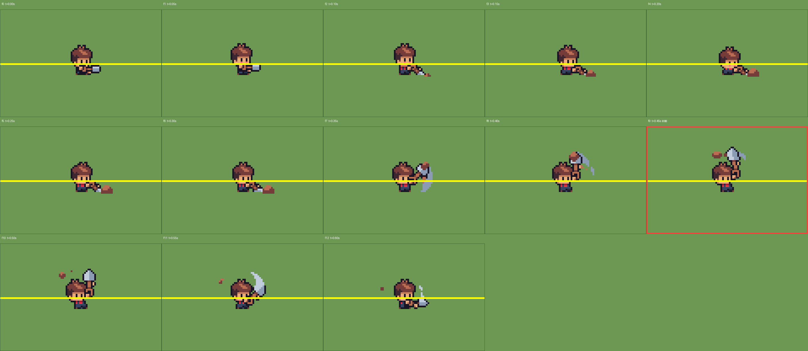

# M2a 第 5 步 · 锄地流程（施工指南）

> 日期：2026-11-09
> 前置：M1（移动/朝向）、三层角色系统、M2a 数据层（FarmData / SoilData）已完成并验收
> 本步目标：按空格 → 播放 dig 动画 → 面向的那一格变成耕地 → 扬起尘土

---

## 0. 这一步要用的素材

### 0.1 耕地贴图：主图集里的实心犁沟土

**主图集 `assets/Tileset/spr_tileset_sunnysideworld_16px.png` 里有现成的翻土纹理**。

对 4096 个 16px tile 做了完整筛选（可无缝平铺 + 棕色主导 + 无绿色），
聚类出 35 种质感，其中 **`atlas(11,3)`** 是实心横向犁沟土：

| atlas 坐标 | 外观 | 判定 |
|---|---|---|
| **`(11,3)`** | 肉棕底 + 横向犁沟波纹 | **✅ 唯一的实心翻土块** |
| `(11,4)` | 同上但沟纹更密 | ⚠ 和 (11,3) 是**同一块地的两个相位**，交替铺会出现棋盘感，别混用 |
| `(14,2)` | 浅肉色 + 十字碎石点 | ⚠ 明度差太多，不适合当耕地 |
| `(12,9)` `(10,9)` `(13,11)` | 深棕**木板** | ❌ |
| `(34,6)` | 有竖缝 | ❌ 平铺会露接缝 |
| `(10,4)` `(10,5)` | 崖边斜坡 | ❌ |
| `(24,25)` `(22,29)` 等 | 熔岩橙 | ❌ |

> 全部 35 种候选：`docs/images/soil_pool_all.png`
> 8 个候选实景对比：`docs/images/soil_candidates.png`

> **这一版就是"普通土块"，不做任何边缘处理。**
> 之前试过"星露谷式软边"方案（按邻域组合切 16 种带草叶的边贴），
> 实机效果不理想，已放弃并删除相关素材 —— 见 `docs/NOTES.md` 末尾的记录。

### 0.2 湿土 / 播种 / 作物：先派生，后面再补

| 状态 | 怎么来 |
|---|---|
| 干土 | `atlas(11,3)` |
| 湿土 | 同一 tile，`modulate` 压暗（M2b 做） |
| 播种 / 作物 | M2b 再做 |

### 0.3 铲子动画：**已经接好了，不用做** ✅

实测确认（`scripts/actors/player.gd` + `scenes/player.tscn`）：

| 动画名 | 在哪 | 用途 |
|---|---|---|
| `use_dig` | `SpriteFrames_y8v0a` | 身体层 |
| `hair_use_dig` | 同上 | 头发层 |
| `tool_use_dig` | 同上 | **工具层（铲子）** |

- 三个动画**帧数、speed 完全一致**（13 帧 / speed 20 / loop=false），
  所以 `_play_anim()` 里按 `"hair_"` / `"tool_"` 前缀拼名字**天然就对齐**，不需要写任何同步代码
- 素材：`assets/Characters/Human/DIG/{base,bowlhair,tools}_dig_strip13.png`（1248×64 = 13 帧 × 96×64）
- `use_tool` 输入映射 = **空格**，已配好
- **实测三层同步：40 帧 0 次失步** ✅

> 命名规则（`base` / `hair_base` / `tool_base`）和已解决的问题见第 2.2 节。

**因此该步骤无需额外操作，直接进入第 3 节编写代码。**

#### use_dig 动画的时序（已逐帧实测）

```
dur = 13 帧 / speed 20 = 0.65 秒
```



| 帧 | 时间 | 画面 |
|---|---|---|
| f0~f6 | 0.00~0.30s | 弯腰，铲子从右往左平推，铲头贴着地面 |
| f7 | 0.35s | 铲头（灰色）从身侧甩出 |
| f8 | 0.40s | 铲子举起 |
| **f9** | **0.45s** | **铲子举到最高 + 土块飞出去 ← 落地帧** |
| f10~f12 | 0.50~0.60s | 土块散开，铲子收回 |

**落地帧 = f9 = 第 10 帧 = t 0.45 秒整。**

> 黄线 = 角色脚底线（节点 y=0）。可以看到 f0~f6 铲头一直贴着这条线，
> f9 铲子抡到最高、**同时有土块（棕色小块）飞出画面**，这就是"这一锄落地"的瞬间。
> f10~f12 是土块飞散和收铲的后摇。

> 巧合但确实：f9 的起始时间 0.45s 正好等于 `dur * 0.69`，
> 而 0.45 秒这个绝对值也是文档第 4 节时间线里用的落点。

### 0.4 尘土特效

| 文件 | 内容 |
|---|---|
| `assets/game/fx/dust_land.png` | 144×9 = **6 帧 24×9 横排** |

> ⚠️ **Godot 4.7 的 `AnimatedSprite2D` 没有 `texture` 和 `hframes` 属性！**
> （这是 Godot 3 的 Sprite 的写法，在 Godot 4 里会报
> `Invalid assignment of property 'texture'`）
>
> 正确做法是用 `SpriteFrames` + `AtlasTexture` 切帧 —— 代码见第 3.4 节 `_spawn_dust()`。

### 0.5 尘土帧序

原 GameMaker 工程已删，**真实帧序无法恢复**。按"面积从小到大"重排了一版
（对应尘土扬起的过程），**顺序为推测值**，可在 Godot 中直接拖动调整。

```
原文件序面积: [96, 5, 64, 44, 80, 23]
重排后:        [5, 23, 44, 64, 80, 96]   ← 小→大
```

对比图：`docs/images/dust_order.png`

---

## 1. 格子对齐规则（已用真实渲染实测确认）


黄色横线 = 角色的脚（y=224）；红色框 = 碰撞盒（12×8，位于节点 (0,−4)）；青色框 = 格 (21,13)。

**结论：**

- 碰撞盒完整落在**青框**里，脚正好压在青框的下边界
- **绿框**（格 21,14）是角色**正前方**那一格

所以：

```gdscript
func _player_cell() -> Vector2i:
	return Vector2i(
		int(floor(position.x / 16.0)),
		int(floor((position.y - 4.0) / 16.0))   # -4 = CollisionShape2D 的 y 偏移
	)
```

**目标格 = 角色格 + facing 向量**（面朝下就是绿框，实测位置正确）。

> 为什么是 `y - 4` 而不是 `y`？
> 碰撞形状 12×8 挂在 `CollisionShape2D` 上、位置 `(0, -4)`，所以碰撞盒中心在节点 y−4。
> 用碰撞盒中心所在格，才和"角色站在这一格"的视觉一致。
> 旧的 `floor((y-1)/16)` 规则在 224 这个初始位置结果相同，但物理意义不如碰撞盒中心明确。

---

## 2. 架构：谁来负责什么

最终落地是这样分的：

| 职责 | 放在哪 | 为什么 |
|---|---|---|
| 算出锄哪一格 | `player.gd` | 只有角色知道自己的位置和朝向 |
| 放动画、锁移动 | `player.gd` | 同上 |
| 记录地块状态 | `FarmData`（autoload） | 全局数据，跟场景无关 |
| **真的画出土块** | **`scripts/world/soil.gd`** | Soil 自己知道怎么画自己 |

**关键决策：Soil 层挂自己的脚本，`player.gd` 通过 `@export` 拿到引用。**

最初方案为让 `player.gd` 通过 `get_tree().get_first_node_in_group("soil")` 查找 Soil，
两个问题：
1. 要手动给节点加 group，容易忘、容易写错大小写（**group 名大小写敏感**）
2. Soil 节点被删了/改名了，`player.gd` 里的 `set_cell` 就找不到对象

改成 `@export` 后：
- 在 Inspector 里**直接把 Soil 节点拖进那个空槽**就行，不用记 group 名
- Inspector 会做类型检查，拖错节点类型立刻报错
- **节点顺序随便调**，拖的是引用不是路径

> 已解决的问题：先试过 `@onready var soil = $../Soil`，
> 但 `$..` 在 Godot 4 的解析有问题，而且 Player → Entities → Main，
> Soil 在 Main 下面，得往上两级。**export 比路径好得多。**

### 2.1 给 Soil 挂脚本

1. 新建 `scripts/world/soil.gd`：

```gdscript
extends TileMapLayer

@export var tex: Texture2D          # 尘土贴图，从 Inspector 拖进来

const SOIL_TILE := Vector2i(11, 3)  # 主图集里的实心犁沟土


## 在某格挖出耕地
func till(cell: Vector2i) -> void:
	set_cell(cell, 0, SOIL_TILE)
	_spawn_dust(cell)


## 扬起的尘土
func _spawn_dust(cell: Vector2i) -> void:
	var sf := SpriteFrames.new()
	sf.set_animation_speed("default", 15.0)      # 6 帧 / 15fps = 0.4 秒
	sf.set_animation_loop("default", false)
	for i in range(6):
		var at := AtlasTexture.new()
		at.atlas = tex
		at.region = Rect2(i * 24, 0, 24, 9)     # 144×9 = 6 帧 24×9
		sf.add_frame("default", at)

	var dust := AnimatedSprite2D.new()
	dust.sprite_frames = sf
	dust.centered = false
	dust.position = Vector2(cell.x * 16 + 8, cell.y * 16 + 10)
	add_child(dust)                              # ← 加到 Soil 下，画在角色之下
	dust.play("default")
	dust.animation_finished.connect(dust.queue_free)
```

2. 打开 `scenes/main.tscn` → 选中 `Soil` → Inspector 顶部脚本图标 → 挂 `soil.gd`
3. Inspector 里把 `assets/game/fx/dust_land.png` 拖进 `tex` 槽

### 2.2 动画命名规则（本次遇到的问题）

三层 SpriteFrames 的命名必须是 **`base` / `hair_base` / `tool_base`**：

| 身体层 | 头发层 | 工具层 | 用途 |
|---|---|---|---|
| `idle` | `hair_idle` | `tool_idle` | 站立 |
| `walk` | `hair_walk` | `tool_walk` | 走路 |
| `run` | `hair_run` | `tool_run` | 跑 |
| **`use_dig`** | **`hair_use_dig`** | **`tool_use_dig`** | 锄地 |

这样 `_play_anim()` 就不用解析名字，直接拼前缀：

```gdscript
func _play_anim(base_name: String) -> void:
	animation.play(base_name)
	hair_sprite.play("hair_" + base_name)
	tool_sprite.play("tool_" + base_name)
```

> ❌ 最初的版本尝试用 `name.split("_")[1]` 取后缀：
> ```gdscript
> var split_name := name_str.split("_")
> var base_name := split_name[1]      # ← "idle".split("_") 只有 1 个元素 → 越界崩溃
> ```
> `idle` / `walk` / `run` 没有下划线，`split("_")` 返回长度 1 的数组，
> 访问 `[1]` 直接越界。**角色一动就报错。**
> 结论：命名统一后就不需要 split 了。

> 💡 以后加"浇水""斧头"等工具动作，就在 SpriteFrames 里加
> `use_water` / `hair_use_water` / `tool_use_water` 三条，
> 代码里 `_start_tool("water")` 就行，命名规则不用变。

### 2.3 尘土的 SpriteFrames 在代码里建

⚠️ **Godot 4.7 的 `AnimatedSprite2D` 没有 `texture` / `hframes` 属性**
→（那是 Godot 3 的 `Sprite` 才有的写法）。

所以**不要在编辑器里预先建 SpriteFrames 资源**，
直接在代码里用 `SpriteFrames` + `AtlasTexture` 切 6 帧就行 —— 见 2.1 节。

> `SpriteFrames.new()` **自带一个名为 `"default"` 的空动画**，
> 所以直接 `add_frame("default", ...)` 即可，**不要再调 `add_animation("default")`**，
> 否则报 `SpriteFrames already has animation 'default'`。

---

## 3. player.gd 的改动

### 3.1 新增常量与变量

```gdscript
@export var soil: TileMapLayer       # 从 Inspector 拖入 Soil 节点

const TILE_SIZE := 16
const FARM_SIZE := Vector2i(40, 26)

var _busy := false          # 锄地中：锁移动 + 锁朝向
```

> `SOIL_TILE` 常量挪到 `soil.gd` 里了 —— 只有 Soil 需要知道用哪块 tile。

### 3.2 `_physics_process` 里加锁

```gdscript
func _physics_process(delta: float) -> void:
	if _busy:
		velocity = Vector2.ZERO
		move_and_slide()
		return          # 提前返回 → 朝向不会被改动
	# ... 原有逻辑不动 ...
```

> 三处锁：`_busy` 期间 velocity=0（锁移动）、提前 return（锁朝向）、
> 目标格在开始时锁存（锁目标）。
> **少了任何一个，按住方向键就会在锄地过程中改变落锄位置。**

#### ⚠️ 这个 `return` 还同时解决了另一个问题（实测确认）

`player.gd` 的 `_physics_process` 每帧都会调 `_play_anim("idle")` 或 `_play_anim("walk")`。
**缺少该 `return` 会导致动画在下一帧立即被覆盖为 idle：**

```
=== A. 不加 _busy 锁的后果 ===
  播 dig 后 2 帧，body.animation = idle
  ⚠ 确认：player.gd 的 _play_anim("idle") 会覆盖 dig -> 必须有 _busy 锁
```

所以这个 `return` **不只是锁朝向，它还是"让动画活下来"的必要条件**。
提前 return 之后 `_play_anim` 不会被调用，动画才能正常播完 13 帧。

### 3.3 触发锄地

在 `_physics_process` 里（`_busy` 判断之后）加：

```gdscript
	if Input.is_action_just_pressed("use_tool"):
		_start_tool("dig")
```

> `use_tool` 已经在 `project.godot` 里映射到**空格**了，不用改。
> 用 `_start_tool("dig")` 而不是 `_start_dig()`，是为了以后能加别的工具。

### 3.4 新增函数

```gdscript
func _start_tool(tool: String) -> void:
	var cell := _target_cell()
	# 越界
	if cell.x < 0 or cell.x >= FARM_SIZE.x or cell.y < 0 or cell.y >= FARM_SIZE.y:
		return
	# 已经锄过
	if FarmData.is_tilled(cell):
		return

	_busy = true
	_play_anim("use_" + tool)

	# 等到"锄头落地"那一刻再改地块
	# use_dig = 13 帧 / speed 20 = 0.65 秒；f9（落地帧）起始正好是 0.45 秒
	await get_tree().create_timer(0.45).timeout
	_apply_till(cell)


func _player_cell() -> Vector2i:
	return Vector2i(
		int(floor(position.x / TILE_SIZE)),
		int(floor((position.y - 4.0) / TILE_SIZE))
	)


func _target_cell() -> Vector2i:
	var c := _player_cell()
	match facing:
		Vector2i.UP:    return c + Vector2i(0, -1)
		Vector2i.DOWN:  return c + Vector2i(0, 1)
		Vector2i.LEFT:  return c + Vector2i(-1, 0)
		Vector2i.RIGHT: return c + Vector2i(1, 0)
	return Vector2i(-999, -999)


func _apply_till(cell: Vector2i) -> void:
	if not FarmData.till(cell):
		return
	soil.till(cell)


func _on_animation_finished() -> void:
	if animation.animation.begins_with("use_"):
		_busy = false
```

**几个要点：**

- **`cell` 用局部变量就够了**，不需要 `_target` 全局变量。
  局部变量在 `await` 前后都是同一个值（`await` 不会改变作用域），
  所以直接 `_apply_till(cell)` 就行，比"存全局再传参"干净。
- **`_on_animation_finished` 必须无参**：Godot 4.7 的 `animation_finished` 信号**不带参数**。
  写成 `func _on_animation_finished(anim_name: String)` 会报
  `Method expected 1 argument(s), but called with 0`。
- **只有 `use_*` 动画会触发这个信号**：`idle`/`walk`/`run` 是循环动画，永远不触发。
- **信号必须在 `_ready()` 里连**：`animation.animation_finished.connect(_on_animation_finished)`

## 4. 时间线（对照检查用）

```
t=0.00  按空格 → _start_tool("dig")：_busy=true，播 use_dig
t=0.45  落地(f9) → FarmData.till() + soil.till() + 尘土出现
t=0.65  use_dig 播完 → animation_finished → _busy=false，恢复移动
```

`use_dig` 动画 = **13 帧 / speed 20 = 0.65 秒**（实测值）。

---

## 5. 验收清单

跑起来按这几条对：

- [ ] 面朝**下**按空格 → 脚下**正前方那一格**变成土块（不是脚下那格，也不是前一格）
- [ ] 面朝**上**按空格 → 头顶那格变土
- [ ] 面朝**左/右**按空格 → 对应方向那格变土
- [ ] **铲子动画完整播放**（能看到角色弯腰、铲子挥动、土块飞出来）
- [ ] **土块在铲子举到最高那一帧出现**（不是提前也不是太晚）
- [ ] 锄地过程中**按住方向键**，角色不会转向、也不会移动
- [ ] 同一格不能重复锄（第二次按没反应）
- [ ] 农场边界外按空格没反应
- [ ] 尘土在**角色脚前方**出现，且**被角色遮挡**（说明 z 序正确）
- [ ] `FarmData.get_tile(锄过的格)` 返回非 null，`state == TILLED`
- [ ] 站到已锄过的格子上，再锄前面那格 → 前面那格变土，脚下那格保持原样
- [ ] 挖出来的土块**和地面严丝合缝**，格子大小一致、没有错位
- [ ] 锄完能**立刻继续走**（`_busy` 正确解冻，没有卡住）
- [ ] **走路/站立动画正常**（三层命名统一后 `idle`/`walk`/`run` 都能播）

---

## 6. 做完这一步之后

- **M2b**：播种（soil_03）、浇水（soil_01 + 蓝色水花）、作物生长、体力条
- 四向移动接入（`docs/FOUR_DIRECTION_ASSETS.md` 里有完整步骤，可以并行做）
- 之后再回头打磨耕地外观（软边 / 草叶过渡），不着急
