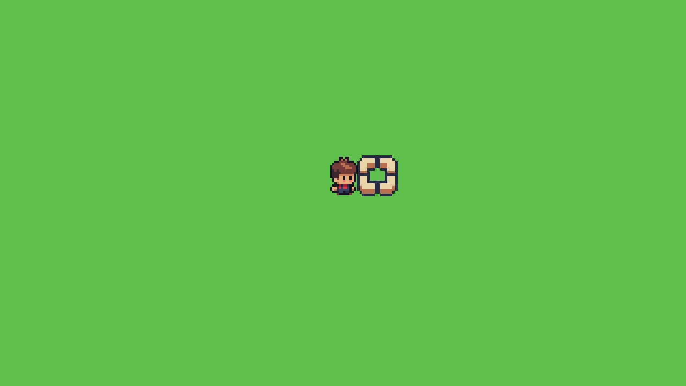

# 工具目标区块（Target Rules）—— 依据星露谷

> 本文档记录**已核实**的星露谷规则，以及我们在 `farm` 项目里的实现取舍。
> 来源：星露谷中文 Wiki「锄头」页 https://zh.stardewvalleywiki.com/锄头
> 抓取时间：2026-11-10

---

## 一、星露谷的"区块选取"其实是两层

很多资料把这两层混在一起说，所以容易学歪。它们是分开的：

| 层 | 问题 | 答案 |
|---|---|---|
| **A. 目标格从哪来** | 这次工具作用在**哪一格**？ | 鼠标模式 = 鼠标光标所在格；手柄模式 = 角色**面前**那一格 |
| **B. 作用范围多大** | 一次工具命中**几格**？ | 由工具等级决定，每级不同 |

### A 层：目标格来源（两种输入方式）

星露谷同时支持两套，切换的是**控制方式**而不是游戏规则：

- **鼠标/键盘**：目标 = 光标指的那一格（SMAPI 叫 `ICursorPosition.Tile`）。
  角色**完全不需要面朝它**。你把鼠标指到哪一格，红框就在哪一格，锄头就锄哪一格。
- **手柄**：目标 = 角色面前那一格（SMAPI 叫 `GrabTile`）。
  没有光标，只能用"角色面朝"来推。

所以"锄地要面朝那格"**只是手柄模式下的降级方案**，不是星露谷的本体规则。

### B 层：作用范围（维基「锄头等级」表原文）

| 工具 | 范围（维基原文） |
|---|---|
| 锄头（初始） | 玩家面朝方向 **1 格** |
| 铜锄头 | 最大范围为玩家面朝方向**直线 3 格** |
| 钢锄头 | 最大范围为玩家面朝方向**直线 5 格** |
| 金锄头 | 最大范围为 **3x3 格** |
| 铱金锄头 | 最大范围为 **6x3 格** |

**关键点**：范围是「**从角色往前推出去的一条线 / 一个方块**」，
不是「以角色为中心的一个半径球」。
铜锄头的"直线 3 格"就是角色前面那 3 格（1、2、3 格全中），横向不扩散；
金锄头的 3×3 才是横向也铺开的方块。

（另：锄头升级后可以按住鼠标左键蓄力，松开时**连续挖多格**，这是另一套机制。）

### 高亮框

星露谷的 "red-border" 是**红色 1px 细边框**，且**覆盖所有会被影响的格子**（不是只框一个）。
对应游戏选项：
- 「一直显示工具目标位置」
- 「移动时隐藏工具目标位置」（默认关闭）

---

## 二、我们现在做的是哪一种

当前实现（`scripts/actors/player.gd`）：

```gdscript
func _player_cell() -> Vector2i:
    return Vector2i(
        floori((position.x - 8.0) / GameConfig.TILE_SIZE),
        floori((position.y - 6.0) / GameConfig.TILE_SIZE)
    )

func _target_cell() -> Vector2i:
    return _player_cell() + facing   # facing 是 UP/DOWN/LEFT/RIGHT
```

也就是：**脚下格 + 面朝方向 1 格**。

对照上面两张表：

- ✅ **规则本身没错**。这正是星露谷「初始锄头 = 面朝方向 1 格」在**手柄模式**下的算法。
- ⚠️ **但它是手柄模式的降级版**，不是星露谷默认体验。星露谷 PC 版默认是光标选取。

---

## 三、真正的三个差异（也就是"感觉不对"的来源）

### 差异 1：没有光标选取，目标只能靠"面朝"推

星露谷 PC 上你锄地，是"鼠标指哪锄哪"，角色朝哪完全无关。
我们现在是"角色朝哪锄哪"——差了一个维度。

### 差异 2：我们的"脚下格"会抖

- 星露谷是**逐格移动**（grid movement）：角色一格一格走，每一步动画走完才停在格中心。
  → 角色的 `position.x` 永远满足 `x ≡ 8 (mod 16)`，脚下格**恒定不变**。
- 我们是**自由连续移动**：`position` 是任意浮点数。
  → 一格 16px，而角色碰撞体只有 12px 宽，脚步稍微一动，
  `floor((x-8)/16)` 就在两格之间跳。

实测数据（`docs/NOTES.md` 已记录）：

```
pos.x=320  脚下格=19  target=20  土块[320..336]  间隙=-8
pos.x=328  脚下格=20  target=21  土块[336..352]  间隙=0
pos.x=336  脚下格=20  target=21  土块[336..352]  间隙=-8
pos.x=344  脚下格=21  target=22  土块[352..368]  间隙=0
```

同样是"面朝右"，走 16px 里目标格换了 2 次。
**星露谷不会出现这种情况**，因为角色站在格中心不会移动。

### 差异 3：我们只有 1 格，没有多格范围

星露谷铜锄头起就是一次锄一条 3 格的直线（还支持蓄力连挖）。
我们永远只能一格一格锄。

---

## 四、三条可选路线（待定夺）

### 路线 A：加光标选取（最接近星露谷 PC 本体）

- 目标格 = 鼠标所在格；角色不必面朝
- 直接消灭差异 1 和差异 2（目标不再依赖脚下格，抖不抖无所谓）
- 天然支持多格范围：红框覆盖所有受影响格
- 代价：
  - 摄像机缩放 4 倍，需要做「屏幕坐标 → 世界坐标 → 格坐标」换算
  - 需要处理"鼠标不在游戏画面内"的状态
  - 键盘玩家要保留 facing 作为回退方案
  - 要加光标图标（星露谷用的是自制的 16px 手形/箭头）

### 路线 B：改成逐格移动（最接近星露谷的手感）

- 角色位置吸附到 16px 网格，走一格一格，动画走过去
- 脚下格恒定 → 消灭差异 2
- 保留"面朝决定目标格"，改动比 A 小
- 代价：移动手感要从"连续滑动"改成"一格一顿"，这是重写级改动，
  但这**本来就是星露谷的味道**
- 顺带：逐格移动也让 A 层的光标选取更好接（两者不冲突）

### 路线 C：最小改动，先稳住

- 保持连续移动 + 面前格
- 把"脚下格"改成**进入时锁定**，只有跨过格线才更新（而不是每帧重算 floor）
- 代价最小，但"必须面朝才能锄"的手感仍在，和星露谷 PC 差得最远

---

## 五、待定事项

1. **选哪条路线**（A / B / C）
2. **作用范围现在做到哪一级**
   - 先只做 1 格（= 星露谷初始锄头，保持现状）
   - 还是现在就把"直线 3 格"做出来（铜锄头体验），并把高亮框改成覆盖多格
3. **高亮框样式**
   - 保留现在的米白+棕四角素材（`assets/game/Select Box/`）
   - 还是改成星露谷官方风格：红色 1px 细框（Line2D）+ alpha 呼吸
     - 顺带：脉冲从 scale 改成 alpha（1px 线放大 1.2 倍会糊，且绕左上角缩放会歪）

---

## 六、这一格到底该怎么算（几何实测）

> 实测图：`docs/images/player_geometry.png`
> （角色帧放大 6 倍，叠加 16px 网格，红十字 = 节点原点）

### 6.1 实测出来的角色几何

角色贴图帧是 **96×64**，但里面的角色只有 **11×16 像素**（其余是空白，留给工具挥舞）。
`AnimatedSprite2D` 默认 `centered = true`，节点偏移 `(0, -6)`：

| 量 | 实测值 |
|---|---|
| 身体像素 x | `position.x - 5` ~ `position.x + 5`（11 宽，**以节点 x 为中心**） |
| 身体像素 y | `position.y - 15` ~ `position.y - 1`（16 高，**脚底就在节点原点**） |
| 身体中心 | `(position.x, position.y - 8)` |
| 碰撞盒 | 12×8 挂在 `(0, -4)` → x ∈ [pos-6, pos+6]，y ∈ [pos-8, pos] |

**结论：节点的原点 = 农夫的脚底线。** 所以"他在哪一格"可以从身体几何直接推出来，
不需要 `-8.0` / `-6.0` 这种凑出来的偏移。

### 6.2 目标格的规则（定案）

```
农夫当前格 = 身体中心所在的那一格
    x = floor(position.x / 16)
    y = floor((position.y - 8) / 16)
目标格 = 当前格 + 朝向
```

对照星露谷：星露谷的农夫是 16px 宽（正好一格），他的"当前格" = `floor(精灵左边 / 16)`，
目标 = 当前格 + 朝向。**当农夫站在格子上时，两种算法完全等价**（身体中心列 = 精灵左边列 + 半格，
而两者的格号相同）。

### 6.3 为什么旧公式会"偏半格"

旧公式 `floor((position.x - 8) / 16)` = 取**身体左边那一列**。
我们的身体只有 11 宽，位置又不跟格子对齐，所以走路时身体经常骑在两列的线上：

```
pos.x = 336（初始位置）
  身体 = 331..341 → 横跨 第20列(320..336) 和 第21列(336..352)，中心正好在 336 这条线上
  旧公式 floor((336-8)/16) = 20  → 目标 = 第21列，锄头落在身体右半边上（重叠 5px）
  新公式 floor(336/16)      = 21  → 目标 = 第22列，锄头落在身体右侧 11px 处（不重叠）
```

**根因**：我们的身体是 11×16，而格子是 16×16。只要农夫是**连续移动**，
身体就有一半时间是骑在格线上的，"他在哪一格"本身就没有唯一答案 → 目标格必然差半格。

| 身体宽 | 身体高 | 骑格线的比例 |
|---|---|---|
| 11px | 16px | 横 ~69% 的时间、纵 ~94% 的时间 |

### 6.4 彻底消除的办法：让农夫按格站（已实现）

农夫的位置只要满足 `x ≡ 8 (mod 16)`、`y ≡ 0 (mod 16)`，身体就永远完整落在**一格**里：

- 身体 x = [16k+3, 16k+13] ⊂ 第 k 列 ✅ 居中（左右各留 3px）
- 身体 y = [16k-15, 16k] = 第 k-1 行 ✅ 严丝合缝
- 目标格 = 相邻格，零误差

这就是**逐格移动（吸附）**：走一格 16px，走完再走下一格，位置永远落在相位上。

#### 实现要点（`scripts/actors/player.gd`）

| 东西 | 作用 |
|---|---|
| `_cell` | 农夫当前所在格（逻辑值，永远精确）|
| `_from` / `_to` / `_t` | 这一步的起点格、终点格、进度 0~1 |
| `_cell_center(c)` | 一个格对应的节点位置：`x = 16*列+8`，`y = 16*(行+1)` |
| `_cell_of(p)` | 节点位置 → 农夫所在格（横=身体中心列，纵=身体中心行）|
| `_step_dir(dir)` | 主轴优先，决定走哪一格 |
| `_can_enter(cell)` | 用物理查询（`intersect_shape`）问墙，挡了就不过去 |

**关键设计：目标格用逻辑值 `_cell`，不用实时位置。**
走路过程中身体在两格之间滑动，如果用实时位置算，"他在哪一格"会飘；
用逻辑值则目标格**只在走完一格时跳一次**，时机干净。

#### 实测结果（真实渲染）

```
position      = (344.0, 224.0)
player_cell   = (21, 13)
body x span   = 339.0 .. 349.0   (第 21 列 = 336..352)   ← 完整在格内，居中
body y span   = 209.0 .. 224.0   (第 13 行 = 208..224)

facing=RIGHT  target=(22, 13)  土块 x=352..368  y=208..224   ← 紧贴身体右缘，间隙 3px
facing=DOWN   target=(21, 14)  土块 x=336..352  y=224..240   ← 紧贴脚底
facing=LEFT   target=(20, 13)  土块 x=320..336  y=208..224   ← 紧贴身体左缘，间隙 3px
facing=UP     target=(21, 12)  土块 x=336..352  y=192..208   ← 紧贴头顶
```

功能测试：

```
半格松手        → 走完整整一格，仍然对齐
一直按左 8 秒   → 停在第 1 列（x=24），不穿墙
一直按右 12 秒  → 停在第 40 列（x=648）
一直按下 10 秒  → 停在第 25 行（y=416）
锄地            → is_tilled(target) = true，土块落在目标格
20 次连续走位    → 始终对齐（x%16==8, y%16==0）
```

**农夫可达范围：列 1~40，行 1~25**（农场是 0~41 列、0~27 行）。
最外一圈站不上去，但**锄得到**（站在第 1 行面朝上就能锄第 0 行）。



### 6.5 星露谷的农夫是逐格移动（吸附）吗？

**结论：是**（依据在下面；官方 wiki 没查到明文，保留一点余地）。

#### 证据 1：最硬的一条 —— 2026-11 上架的 "Smooth Movement Overhaul" 模组

https://www.nexusmods.com/stardewvalley/mods/55240

这个模组的存在意义就是"把原版的逐格移动改成顺滑移动"，它的全部卖点都建立在
**原版是整格跳跃**这个前提上：

> - **Skid & Turn Deceleration**: Abruptly reversing direction triggers a satisfying skid
>   effect with dust particles instead of an **instant mechanical snap**.
>   （原版转向是"机械式硬切" —— 只有逐格移动才有这种手感）
> - **Corner Sliding**: Glancing collisions against fence edges or trees smoothly glide you
>   around the corner rather than **stopping you dead in your tracks**.
>   （原版撞到墙角会"直接停死"，不会沿墙滑行 —— 连续物理移动会自然滑行）
> - **dynamic sprite tilting, and squash-and-stretch animations**（原版没有）

"撞墙不滑行" + "转向硬切"这两条，只有在**每步只走一整格、撞到就停**时才会出现。

#### 证据 2：走路动画正好 4 帧走 1 格

星露谷 Wiki「Modding:Farmer sprite」：
`Walking, down: R1F1, R1F2, R1F1, R1F3, repeat`
—— 一个循环 = 4 帧 = 1 格，动画周期和格子一一对应。

#### 证据 3：农夫精灵 16×32，脚步按格锚定

精灵是 2 格高，逻辑位置锚在格子上，画的起点是整格。

#### 我们和星露谷的差异

| | 星露谷 | 我们 |
|---|---|---|
| 角色高度 | 16×32（2 格高）| 16×16（1 格高）|
| "当前格" | 脚踩的那一格 | 身体所在的那一格 |
| 斜着走 | 可以（同时按两个方向 → 两轴各走一格）| 不行（纯四方向）|
| 撞墙角 | 停死，不滑行 | 停死，不滑行 ✅ 同款 |
| 转向时机 | **走完这格再转** | 立刻转向，但这格继续走完（可改）|
| 松开方向键 | 当前这格走完 | 当前这格走完 ✅ 同款 |

---

## 七、素材致谢

- 星露谷 / Sunnyside 相关资源：Daniel Diggle，https://danieldiggle.itch.io/sunnyside
- 规则参考：Stardew Valley Wiki（中文），https://zh.stardewvalleywiki.com/
